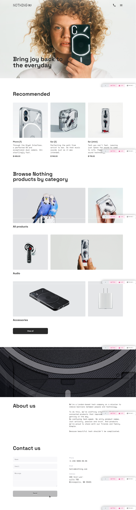
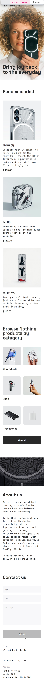

# Nothing

- **Methodology:** BEM + ITCSS
- **Figma template:** https://www.figma.com/design/xIVUXiPZ3hdpEFiIC0qbTL/BOSE-New-Version?node-id=6802-139&p=f&t=Skvqrbk4qw0MADZ2-0
- **DEMO** [https://udalovivanw.github.io/landing-nothing/](https://udalovivanw.github.io/landing-nothing/)

## Command list

| Команда           | Призначення                                                                            |
| :---------------- | :------------------------------------------------------------------------------------- |
| `npm install`     | Встановлення залежностей із `package-lock.json` та ініціалізація Git-хуків (`prepare`) |
| `npm run dev`     | Запуск dev-сервера Vite (`http://localhost:5173/`)                                     |
| `npm run build`   | Збірка у `dist/` (компіляція Pug/SCSS, PostCSS, мініфікація)                           |
| `npm run preview` | Локальний перегляд зібраного проєкту (`http://localhost:4173/landing-nothing/`)        |
| `npm run images`  | Пакетна конвертація оригіналів у AVIF, WebP та JPEG (`400w` і `800w`) через `sharp`    |
| `npm run format`  | Prettier                                                                               |
| `npm run lint`    | Перевірка якості SCSS (`stylelint`) та стилю форматування (`prettier --check`)         |

## TESTS

- PageSpeed Insights: https://pagespeed.web.dev/analysis/https-udalovivanw-github-io-landing-nothing/a98q34i3j7?form_factor=mobile
- W3 Validator: https://validator.w3.org/nu/?level=warning&doc=https%3A%2F%2Fudalovivanw.github.io%2Flanding-nothing%2F
- Perfect pixel screenshots:
  
  
  
