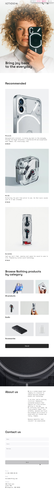

# Nothing

- **Methodology:** BEM + ITCSS
- **Figma template:** https://www.figma.com/design/xIVUXiPZ3hdpEFiIC0qbTL/BOSE-New-Version?node-id=6802-139&p=f&t=Skvqrbk4qw0MADZ2-0
- **DEMO** [https://udalovivanw.github.io/landing-nothing/](https://udalovivanw.github.io/landing-nothing/)

## Command list

| Команда           | Призначення                                                                            |
| :---------------- | :------------------------------------------------------------------------------------- |
| `npm install`     | Встановлення залежностей із `package-lock.json` та ініціалізація Git-хуків (`prepare`) |
| `npm run dev`     | Запуск dev-сервера Vite (`http://localhost:5173/`)                                     |
| `npm run build`   | Збірка у `dist/` (компіляція Pug/SCSS, PostCSS, мініфікація)                           |
| `npm run preview` | Локальний перегляд зібраного проєкту (`http://localhost:4173/landing-nothing/`)        |
| `npm run images`  | Пакетна конвертація оригіналів у AVIF, WebP та JPEG (`400w` і `800w`) через `sharp`    |
| `npm run format`  | Prettier                                                                               |
| `npm run lint`    | Перевірка якості SCSS (`stylelint`) та стилю форматування (`prettier --check`)         |

---

## Декомпозиція сторінки

- **`c-page`** — кореневий блок сторінки (типографіка, фон, блокування скролу при відкритому меню).
- **`c-hero`** — перший екран на всю висоту в’юпорту з адаптивним фоном (`+art-picture`) та заголовком `h1`.
- **`c-header`** — шапка з логотипом, посиланням `tel:` та кнопкою відкриття меню.
- **`c-menu`** — повноекранне навігаційне меню на чистому CSS через `:target`.
- **`c-section`** — базова обгортка секцій із єдиними відступами та заголовками `h2`.
- **`c-recommended`** — секція рекомендованих товарів.
- **`c-product-card`** — картка продукту (адаптивне зображення, назва, опис, ціна).
- **`c-categories`** — секція категорій товарів (_All products_, _Audio_, _Accessories_).
- **`c-category`** — картка категорії з парою асиметричних зображень і підписом.
- **`c-banner`** — повноширинний декоративний банер із текстурою аудіопристрою.
- **`c-about`** — секція _About us_ із заголовком та описом бренду.
- **`c-contacts`** — секція контактів і футер із формою зворотного зв’язку та реквізитами.
- **`c-button`** — універсальна кнопка зі станами `:hover`, `:focus-visible` та `:active`.
- **`c-field`** — поля введення форми (`input`, `textarea`) з нативною HTML5-валідацією.

---

## Архітектура ITCSS

```text
src/styles/
├── 1-settings/     # змінні, токени, map-и брейкпоінтів
├── 2-tools/        # міксини, функції
├── 3-generic/      # reset/normalize, box-sizing
├── 4-elements/     # стилі HTML-елементів без класів (h1-h6, a, img, body)
├── 5-objects/      # o-container, o-grid, o-media - структура без оформлення
├── 6-components/   # c-header, c-product-card, c-button ... - BEM-блоки
├── 7-utilities/    # u-visually-hidden, u-text-center ... (допускається !important)
└── main.scss
```

## GRID

| Ширина фрейму    | Колонки | Ширина колонки | Gutter |      Margin (поля)       |
| :--------------- | :-----: | :------------: | :----: | :----------------------: |
| 320              |    2    |     130px      |  20px  |           20px           |
| 744              |    6    |      80px      |  24px  |           72px           |
| 1260 (max width) |   12    |      63px      |  24px  | 120px (контент — 1020px) |

## TESTS

- PageSpeed Insights: https://pagespeed.web.dev/analysis/https-udalovivanw-github-io-landing-nothing/a98q34i3j7?form_factor=mobile
- W3 Validator: https://validator.w3.org/nu/?level=warning&doc=https%3A%2F%2Fudalovivanw.github.io%2Flanding-nothing%2F
- Perfect pixel screenshots:
  
  
  
